

# Plataforma de torneos de esports

### RAGNAROK · U-Series

Inscripciones, equipos, salas, partidas y resultados en una web. 
La organización controla la competición desde un panel independiente.

**[Visitar la plataforma](https://ragnarokseries.games/)** · [Modalidades](#modalidades) · [Panel de administración](#panel-de-administración) · [Contacto](https://github.com/Maiky77)

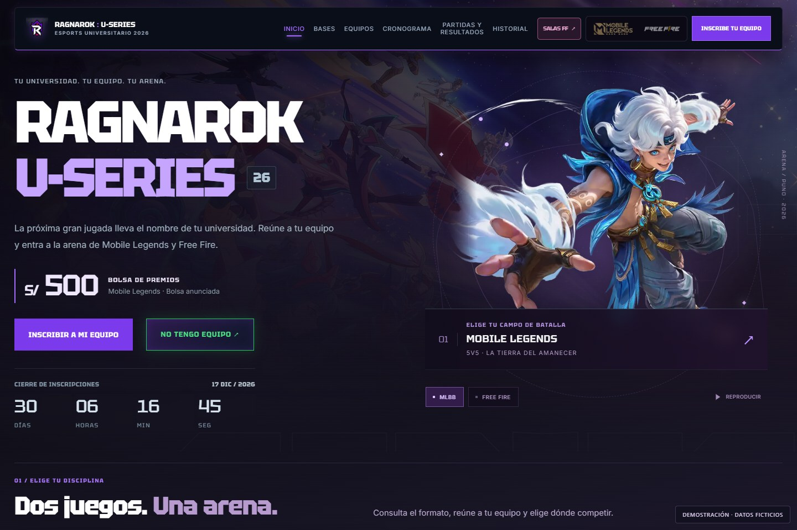

> **Este repositorio presenta el proyecto mediante capturas y documentación. El código fuente de la web, del panel y de la base de datos se mantiene privado.**
>
> Las capturas muestran las interfaces del proyecto con datos ficticios. Los equipos, jugadores, cupos, importes y resultados son ejemplos; no representan participantes ni operaciones reales.

## La plataforma

RAGNAROK U-Series reúne la participación y el seguimiento de torneos de **Free Fire** y **Mobile Legends: Bang Bang**. Está abierta a universidades, institutos, colegios y jugadores independientes.

El jugador elige una modalidad, registra sus datos, adjunta el comprobante de inscripción y consulta su participación. El organizador revisa las solicitudes desde el panel, aprueba participantes, prepara las partidas y publica los resultados.

Fechas, cupos, tarifas, premios, bases y estados de las salas se administran desde el panel, sin tener que editar el código de la página para cada torneo.

## Modalidades

| Competencia | Participación | Cómo se premia o clasifica |
| --- | --- | --- |
| Mobile Legends | Equipos de 5 jugadores, con suplentes | Partidas y fases del torneo |
| Free Fire · Escuadras | Equipos de 4 jugadores, con suplente | Puesto, kills y puntuación configurada |
| Free Fire · Solo por kills y Booyah | Un jugador por inscripción | Premio por kills y bono Booyah |
| Free Fire · Solo por Top | Un jugador por inscripción | Importe fijo según el puesto final |
| Free Fire · Dúo por kills y Booyah | Dos jugadores por inscripción | Suma de kills de la pareja y bono Booyah |
| Free Fire · Dúo por Top | Dos jugadores por inscripción | Importe fijo según el puesto de la pareja |

En Dúo, una pareja ocupa **un cupo y un slot**. La tarifa es por pareja y el premio se dirige al único Yape registrado para esa inscripción.

También existe un registro individual para jugadores que quieren **formar una escuadra**. Es un flujo distinto de las salas Solo.

## Salas Free Fire

Los filtros **Todas · Solo · Dúo** permiten encontrar las salas por participación. Cada tarjeta identifica su modalidad y muestra el precio, el inicio de la partida, el cierre de inscripción, la disponibilidad y los premios.

Una sala puede anunciarse antes de abrir sus inscripciones. Sus estados de borrador, pausa, apertura, partida en curso y finalización se controlan desde el panel.

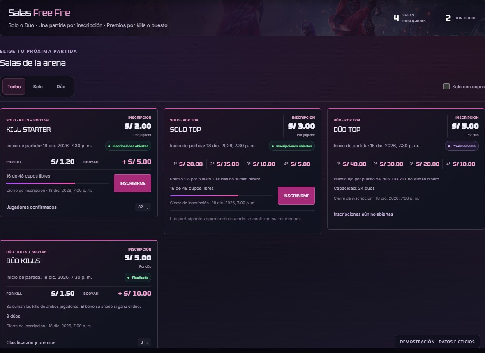

Los listados permiten consultar el slot asignado, buscar por nombre del juego y revisar los premios publicados al terminar la partida. En Dúo, ambos integrantes aparecen bajo el mismo slot.

## Inscripción por pasos

El formulario guía al participante por tres etapas: **sala o equipo**, **jugadores** y **pago y confirmación**.

- Selección de la sala correspondiente desde su tarjeta.
- Registro del nombre del juego, conservando símbolos y caracteres especiales.
- WhatsApp de contacto y Yape para recibir premios como datos separados, con una opción para usar el mismo número.
- Comprobante de inscripción y aceptación de condiciones.
- Confirmación de solicitud enviada y mensaje preparado para contactar a la organización por WhatsApp. El participante confirma el envío en WhatsApp.
- Protección frente a envíos repetidos y reintentos de una misma solicitud.

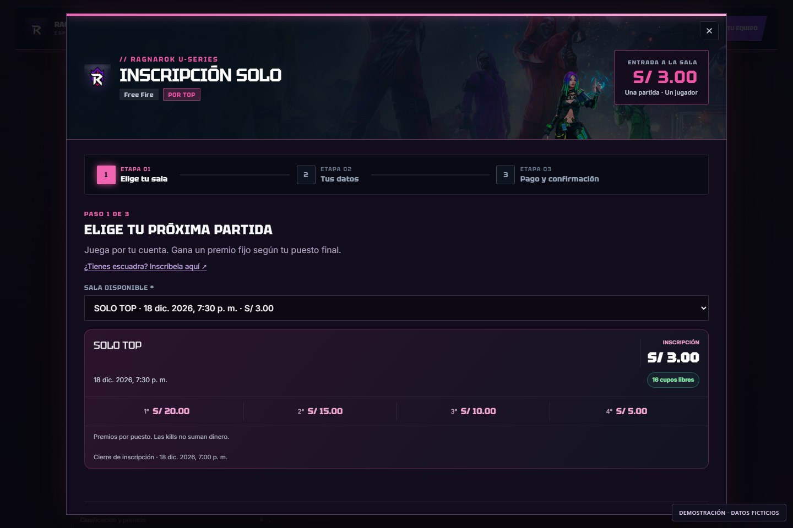

La confirmación inicial significa **pendiente de revisión**. La aprobación y la asignación del slot se realizan desde el panel.

## Equipos, partidas y podios

Las escuadras aprobadas se presentan con su identidad e integrantes. Los espectadores pueden seguir los enfrentamientos, los marcadores y los resultados de la competición.

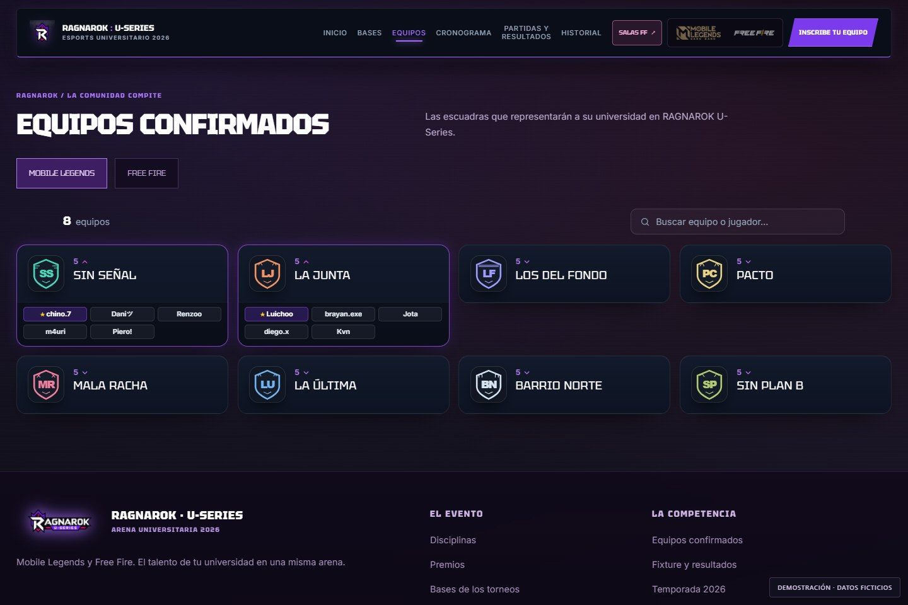

### Partidas y resultados

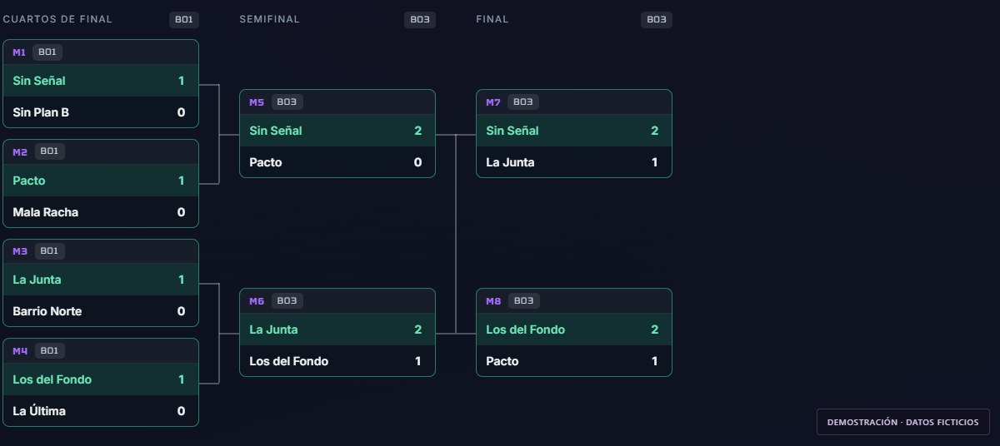

### Ganadores

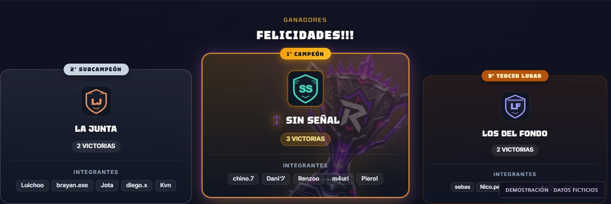

El sitio también reúne las **bases**, el **cronograma** y el **historial de ediciones publicadas**.

## Panel de administración

El panel es una aplicación separada del sitio público. Tiene autenticación y permisos por rol para las tareas de organización y revisión.

Desde allí se puede:

- Revisar inscripciones, comprobar pagos y aprobar o rechazar solicitudes.
- Administrar juegos, cupos, tarifas, premios y apertura de inscripciones.
- Crear, anunciar, pausar, cerrar y finalizar salas.
- Asignar slots y gestionar participantes Solo y Dúo.
- Organizar grupos y fases, registrar marcadores y publicar podios.
- Gestionar resultados y pagos de premios de las salas.
- Editar contenido, bases, cronograma y enlaces de transmisiones.
- Publicar el historial y consultar el registro de acciones administrativas.

### Resumen de la organización

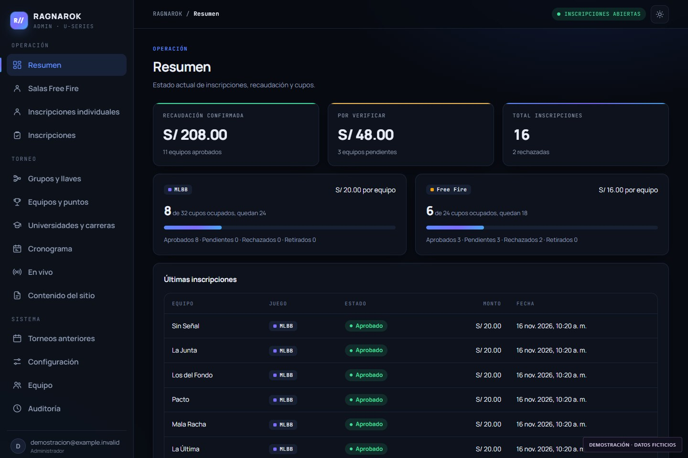

### Gestión de salas y resultados

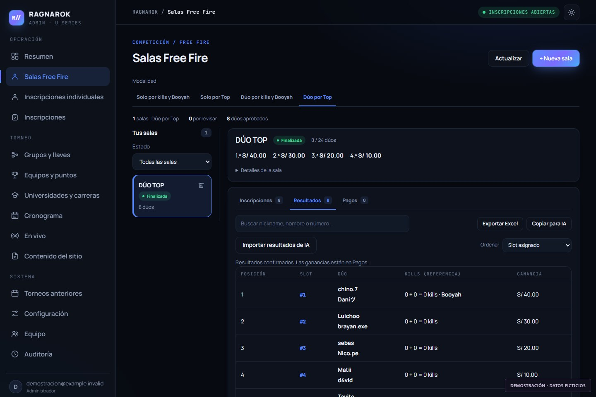

**Lo que administra la organización se refleja en las vistas públicas correspondientes.** Los contactos, los comprobantes y los datos de acceso de las salas no se publican en los listados de jugadores o resultados.

## También en celular

La portada, las tarjetas y los formularios se adaptan a pantallas pequeñas. La inscripción utiliza una cabecera compacta, campos identificados, botones para pegar nombres y un QR que puede ampliarse.

  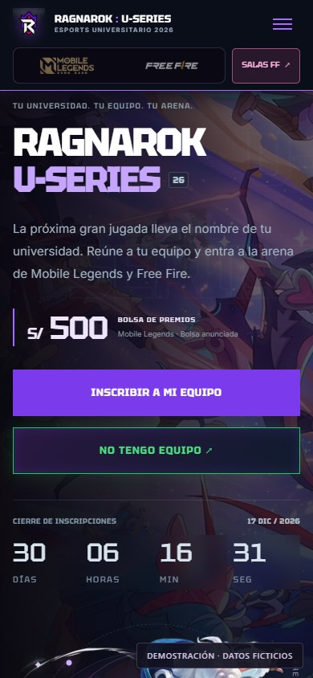
  &nbsp;&nbsp;
  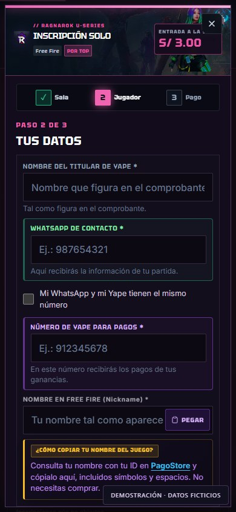

## Cómo se organiza el sistema

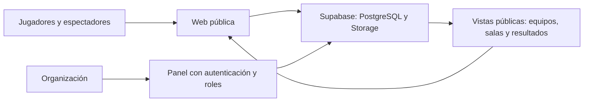

| Parte | Tecnologías |
| --- | --- |
| Web pública | React, Vite, React Router, CSS adaptable y React Hook Form |
| Panel administrativo | React, Vite y React Router |
| Datos y archivos | Supabase, PostgreSQL y Supabase Storage |
| Acceso administrativo | Supabase Auth y permisos por rol |
| Publicación de la web | Vercel y dominio propio |

La validación de inscripciones y disponibilidad se comprueba también en el backend. Los comprobantes se guardan en almacenamiento privado; las pantallas públicas utilizan las vistas destinadas a mostrar información de la competición.

## Sobre este repositorio

Aquí encontrarás la presentación y las capturas del sistema. No contiene una aplicación instalable, un clon de la base de datos, credenciales ni registros de participantes.

Las imágenes de los juegos y sus marcas corresponden a sus respectivos titulares. Su aparición ilustra las modalidades soportadas; no implica una afiliación oficial.

## Contacto

¿Tienes un proyecto en mente? Puedes encontrarme en **[GitHub · Maiky77](https://github.com/Maiky77)**.

**[Conocer la plataforma](https://ragnarokseries.games/)** · [Volver arriba](#plataforma-de-torneos-de-esports)